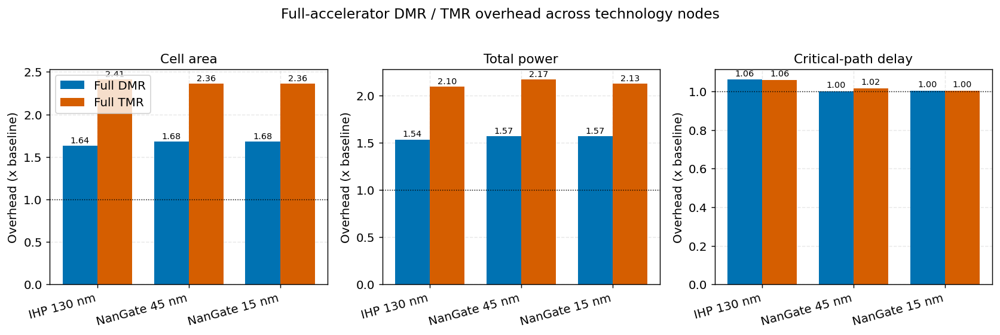

# Fault tolerance and in-field monitoring for the Klessydra RISC-V vector accelerator

Master's thesis in Mechatronic Engineering at Politecnico di Torino (2026): *Design-Space Exploration of Fault-Tolerance and In-Field Monitoring Techniques for the Klessydra RISC-V Vector Accelerator*.

The vector (DSP) accelerator of the Klessydra RISC-V core is hardened against faults and made observable in the field, then every variant is synthesized on three technology nodes to measure what the protection costs in area, power and timing.



## What's in the work

1. **Modular redesign.** The originally monolithic VHDL accelerator is split into isolated functional units (adders, multipliers, shifters, comparators, accumulator), so protection can be applied one unit at a time.
2. **Redundancy.** Reusable Dual Modular Redundancy (DMR, error detection through an error flag) and Triple Modular Redundancy (TMR, error masking through majority voting) wrappers, applied to single units or to the whole accelerator.
3. **In-field monitoring.** An automated tool inserts IEEE 1687 (IJTAG) thermal and activity sensors into the VHDL hierarchy and generates the Siemens Tessent scripts that build the on-chip access network. It is also published on its own as [ijtag-sensor-tool](https://github.com/BoulosMansour/ijtag-sensor-tool).
4. **Cross-node synthesis study.** Every configuration is verified in simulation and synthesized with Synopsys Design Compiler at 130 nm (IHP SG13G2), 45 nm and 15 nm (NanGate Open Cell Libraries), across process corners.

## Repository layout

| Path | Contents |
| --- | --- |
| `DSP_BreakDown/modules/` | VHDL of the modular accelerator; `hardening/` holds the DMR and TMR wrappers |
| `DSP_BreakDown/tb/`, `DSP_BreakDown/test/` | Testbenches and test vectors (convolution, matrix multiply, shift and compare workloads) |
| `DSP_BreakDown/do/` | Simulation scripts, the Design Compiler flow (`synthesis.tcl`) and `run_synthesis_sweep.py`, which runs every configuration on every node |
| `DSP_BreakDown/do/synthesis_runs/` | Area, power, timing and cell reports for each run |
| `ijtag-sensor-tool/` | The IJTAG sensor insertion tool |
| `tech/` | Technology files used by the flows (IHP SG13G2 open PDK, Tessent cell libraries) |
| `thesis/` | LaTeX source of the thesis, with the plots generated from the synthesis data |
| `abstract.md` | Full abstract |

## Reproducing the synthesis sweep

Requires Synopsys Design Compiler. From `DSP_BreakDown/do/`:

```bash
python run_synthesis_sweep.py --dry-run   # list the runs without executing them
python run_synthesis_sweep.py             # run every configuration on every node
```

Each run writes its reports to `synthesis_runs/tech_<node>/<corner>/<scenario>/<configuration>/`.

## Third-party material

The Klessydra cores and the technology libraries (IHP SG13G2, NanGate Open Cell Libraries) belong to their respective authors and keep their original licenses.
